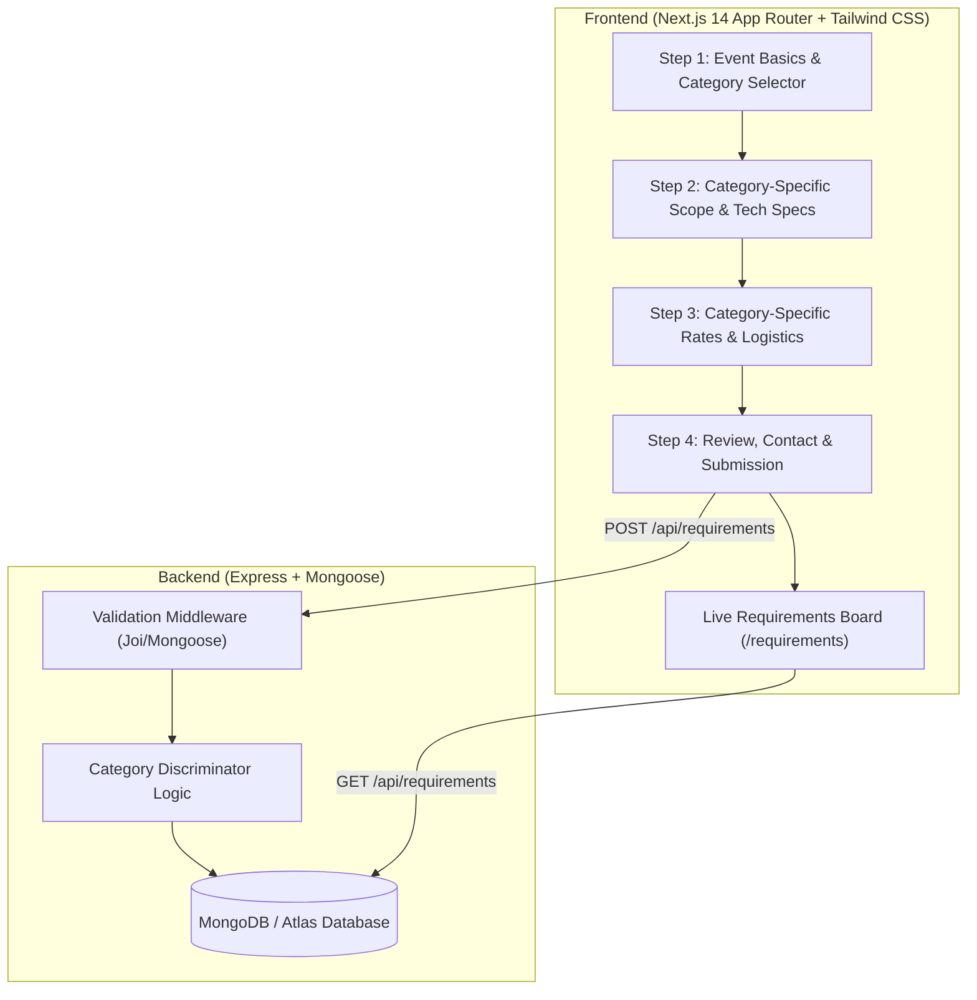

# StageSync — Event Requirement Posting Platform

A production-grade, full-stack event requirement posting flow built with **Next.js 14 (App Router)**, **Tailwind CSS**, **Node.js + Express**, and **MongoDB (Mongoose)**.

---

## 🌟 Overview & Key Capabilities

StageSync streamlines the posting and management of event talent and staffing requirements across three core categories: **Event Planners**, **Performers**, and **Production Crew**.



### 🎯 Multi-Step Posting Flow Highlights
1. **Step 1 — Event Fundamentals**:
   - Captures Event Name (with character counter), Event Type (Weddings, Festivals, Galas, Conferences, etc.).
   - Flexible date picker: toggle between **Single Day** and **Multi-day Date Range** with daily call/wrap times.
   - Geographic location (City, State, Country, Address) and Venue status (Venue Name, Indoor/Outdoor setting, Confirmed vs. Scouting).
   - **Category Selector**: 3 prominent, visually rich cards (**Event Planner**, **Performer & Artist**, **Production Crew**).
2. **Step 2 & 3 — Category-Specific Adaptive Forms**:
   - **Event Planner**:
     - *Step 2*: Planning Service Level (*Full-Service, Month-of, Day-of only, Styling only*), Estimated Guest count with interactive slider & quick badges, Theme aesthetic, Decor & staging requirements (*Floral mandap, ambient lighting, photo backdrop, etc.*).
     - *Step 3*: Target Planning Fee / Budget range (*Min & Max in USD/INR/EUR*), Specific deliverables (*Vendor sourcing, budget management, run of show, permits, etc.*), Planning milestones, and VIP considerations.
   - **Performer & Artist**:
     - *Step 2*: Performer specialty (*Live Band, DJ/Producer, Solo Vocalist, Magician, Comedian, MC, etc.*), Performance format & duration, Target musical genres, On-stage audio technical specs (*PA system toggle, Microphones count, In-Ear Monitors, Backline gear multi-select*).
     - *Step 3*: Compensation model (*Fixed Fee vs. Hourly Rate*), Sound check / rehearsal call window, Hospitality rider (*Green room, catered meals, parking pass, secure gear storage*), Travel policy (*Local only, Reimbursed, Flights & Hotel covered*), and Audience vibe notes.
   - **Production Crew**:
     - *Step 2*: Dynamic Crew Roles table (*FOH Audio Engineer, Lighting Designer, Camera Operator, Stagehand, Security, Usher, etc.*) with individual headcounts and call/wrap shift timings, Real-time sum of total crew members, Required experience level (*Entry, Intermediate, Certified Lead*).
     - *Step 3*: Compensation structure (*Flat Day Rate vs. Hourly Rate + Overtime terms*), Dress code (*Event Blacks, Smart Casual, Formal, Hi-Vis*), Tool & equipment policy, Mandatory certifications (*Electrical Safety, Rigging, First Aid/CPR*), and Crew amenities.
3. **Step 4 — Review & Persistent Submission**:
   - Comprehensive interactive review card displaying all entered details with quick "Edit" buttons to jump directly to any prior step.
   - Poster & Contact details (*Full name, organization, verified email, phone number, preferred contact channel*).
   - Generates a human-readable tracking code (e.g., `PLA-2026-X8F2`, `PER-2026-5CGS`, `CRE-2026-SEED3`).
   - Saves to MongoDB with clean schema partitioning.
   - Triggers celebratory confetti modal with 1-click code copying and links to view the requirement in the live board.
4. **Live Requirements Board (`/requirements`)**:
   - Real-time directory fetching directly from MongoDB.
   - Aggregate metrics summary bar (*Total requirements, Planners, Performers, Crew*).
   - Filter tabs by category, search by title/city/reference code.
   - Detail modal drawer inspecting the complete database document.
   - 1-click **"Load Sample Data"** button to seed benchmark records instantly.

---

## 🏗️ Architecture & Key Engineering Decisions

### 1. Dynamic Form Adaptability & State Resilience
- **Category-Driven Schema Switching**: The form state dynamically mounts category components while preserving common event basics.
- **LocalStorage Draft Auto-Save**: In-progress entries are seamlessly saved to `localStorage` (`stagesync_requirement_draft_v1`), protecting users against accidental reloads or connection drops.
- **Progressive Validation**: Step validation checks required fields and formats before allowing advancement, providing actionable inline error messages.

### 2. Backend Schema Design & Data Hygiene
- **Strict Partitioning**: When a requirement is saved as `planner`, any stray `performerDetails` or `crewDetails` are stripped before saving to ensure database cleanliness.
- **MongoDB Schema Discriminators**: Subdocuments (`plannerDetailsSchema`, `performerDetailsSchema`, `crewDetailsSchema`) enforce strict validation rules conditionally based on `category`.
- **Compound & Text Indexes**: Indexed by `{ category: 1, status: 1, createdAt: -1 }` and text search on `{ eventName: 'text', 'location.city': 'text' }` for lightning-fast queries.

### 3. Zero-Config Local Developer Experience
- **Embedded In-Memory MongoDB Fallback**: The backend includes `mongodb-memory-server` as an automatic fallback if no `MONGODB_URI` is provided in `.env`. Anyone cloning the repository can run `npm run dev` and start posting requirements immediately without installing or running a local MongoDB daemon!
- Seamlessly connects to **MongoDB Atlas** or production MongoDB when `MONGODB_URI` is defined.

---

## 🚀 Quick Start Guide

### Prerequisites
- Node.js >= 18.x (Tested on Node v20 & v22)
- npm >= 9.x

### 1. Clone & Install
```bash
git clone <your-repo-url>
cd <repo-folder>

# Install all dependencies (frontend + backend)
npm run install:all
```

### 2. Environment Setup (Optional)
The backend already works out-of-the-box using the embedded in-memory database. To persist data to MongoDB Atlas, create `backend/.env`:
```env
PORT=5001
NODE_ENV=development
MONGODB_URI=mongodb+srv://<username>:<password>@cluster0.mongodb.net/event_requirements?retryWrites=true&w=majority
```

For the frontend, `frontend/.env.local` defaults to `http://localhost:5001/api`.

### 3. Run the Full-Stack Application
To start both the Express backend and the Next.js frontend concurrently with a single command:
```bash
npm run dev
```

- 💻 **Frontend Web App**: [http://localhost:3000](http://localhost:3000)
- 📋 **Live Requirements Board**: [http://localhost:3000/requirements](http://localhost:3000/requirements)
- 📡 **Backend API Server**: [http://localhost:5001](http://localhost:5001)
- 🩺 **API Health Check**: [http://localhost:5001/api/health](http://localhost:5001/api/health)

---

## 🧪 Automated Testing

The backend includes a comprehensive automated test suite covering API endpoints, data validation, category discriminators, and MongoDB persistence.

Run the tests:
```bash
npm test
```

### Test Suite Coverage:
- `GET /api/health` — Returns `200` healthy status.
- `POST /api/requirements` (Category: Planner) — Generates reference code (`PLA-`), validates guest count and service level.
- `POST /api/requirements` (Category: Performer) — Generates reference code (`PER-`), validates performer type and sound specs.
- `POST /api/requirements` (Category: Crew) — Generates reference code (`CRE-`), validates dynamic roles and headcount.
- `POST /api/requirements` (Validation Failures) — Returns `400` with field-level error messages.
- `GET /api/requirements` (Filtering) — Filters by `?category=planner|performer|crew`.
- `GET /api/requirements/stats` — Returns aggregate counts grouped by category.

---

## 📡 REST API Documentation

### 1. Health Check
```http
GET /api/health
```
**Response (200 OK):**
```json
{
  "status": "healthy",
  "timestamp": "2026-10-26T11:00:00.000Z",
  "uptime": 124.5,
  "service": "Event Requirement API"
}
```

### 2. Create Requirement
```http
POST /api/requirements
Content-Type: application/json
```
**Request Body (Performer Example):**
```json
{
  "eventName": "Sunwave Electronic Fest 2026",
  "eventType": "Music Festival / Concert",
  "dateType": "single",
  "startDate": "2026-12-19",
  "location": { "city": "Goa", "state": "Goa", "country": "India" },
  "venue": { "name": "Vagator Beach Arena", "venueType": "Outdoor", "isVenueBooked": true },
  "category": "performer",
  "performerDetails": {
    "performerType": "DJ / Electronic Producer",
    "performanceFormat": "1 x 90-min headline set",
    "genres": ["EDM / Electronic / House"],
    "soundTechNeeds": {
      "paSystemProvided": true,
      "microphonesNeeded": 2,
      "inEarMonitorsNeeded": true,
      "backlineRequired": ["Pioneer CDJ-3000 x2 + DJM-900 Mixer"]
    },
    "compensation": { "amount": 5500, "rateType": "fixed", "currency": "USD" },
    "travelAccommodation": "Flights & Hotel Covered"
  },
  "contact": {
    "fullName": "Kavita Nair",
    "email": "kavita@sunwavelive.example.com",
    "phone": "+91 98111 22334"
  }
}
```
**Response (201 Created):**
```json
{
  "success": true,
  "message": "Requirement successfully created under 'performer' category.",
  "data": {
    "_id": "6adf32a5b8ca6fa6a7ca966e",
    "referenceCode": "PER-2026-5CGS",
    "category": "performer",
    "eventName": "Sunwave Electronic Fest 2026",
    "status": "active",
    "createdAt": "2026-10-26T10:59:49.199Z"
  }
}
```

### 3. List Requirements (with filtering & search)
```http
GET /api/requirements?category=crew&search=Mumbai&page=1&limit=20
```

### 4. Get Requirement by ID or Reference Code
```http
GET /api/requirements/PER-2026-5CGS
GET /api/requirements/6adf32a5b8ca6fa6a7ca966e
```

### 5. Category Stats Breakdown
```http
GET /api/requirements/stats
```
**Response (200 OK):**
```json
{
  "success": true,
  "data": {
    "total": 4,
    "planner": 1,
    "performer": 2,
    "crew": 1
  }
}
```

### 6. Seed Benchmark Data
```http
POST /api/requirements/seed
```

---

## 🎥 5-7 Minute Screen Recording Script & Walkthrough Notes

Here is a structured walkthrough outline for your video submission:

### 1. Introduction & Problem Understanding (~1:00 min)
- *"Hello! Today I'm presenting StageSync, an end-to-end requirement posting flow for events. The objective was to build a dynamic multi-step posting experience with Next.js, backed by Node.js, Express, and MongoDB."*
- Highlight the core requirement: Step 1 collects event basics and selects between **Event Planner**, **Performer**, or **Production Crew**, and Steps 2 and 3 dynamically adapt to surface fields uniquely relevant to that category.

### 2. Frontend Architecture & Multi-Step Flow (~2:00 mins)
- **Step 1 (Event Basics)**: Show entering event title, date range toggle, location, and venue status. Walk through the 3 category cards and show the visual feedback.
- **Preset Quick-Fill**: Demonstrate clicking the header quick-fill button (`Royal Wedding`, `Festival DJ`, or `AV Crew`) to demonstrate rapid workflow testing.
- **Steps 2 & 3 (Category Adaptation)**:
  - Demonstrate **Planner**: point out Planning Service Level, Guest Count stepper, Theme aesthetic, Budget range, and Deliverables checkboxes.
  - Switch to **Performer**: show Performer Type, Format & duration, Music genres, PA toggle, Microphone stepper, In-Ear monitors, Backline equipment, and Hospitality rider.
  - Switch to **Crew**: showcase the dynamic crew table where multiple roles can be added with headcount and shift call/wrap times, live headcount summing, experience levels, and day/hourly pay rates.
- **Step 4 (Review & Submit)**: Show the structured review card with edit shortcuts, enter contact information, and click **Post Requirement**. Point out the confetti celebration, reference code generation (`PLA-2026-...`), and 1-click clipboard copy.

### 3. Backend, API Request/Response & MongoDB Flow (~1:30 mins)
- Open developer tools (Network tab) or terminal:
  - Show the `POST /api/requirements` request payload and `201 Created` response.
  - Explain how the Express validator ensures required fields and how the Mongoose pre-save hook generates unique tracking codes.
  - Explain data partitioning: how `plannerDetails`, `performerDetails`, and `crewDetails` are isolated based on the category discriminator.

### 4. Live Requirements Board & Database Verification (~1:00 min)
- Navigate to `/requirements`.
- Show how the newly posted requirement appears immediately in the directory.
- Click the category filter tabs (`Planners`, `Performers`, `Crew`) to prove data classification in MongoDB.
- Open the **View Full Details** modal to display the persisted MongoDB document.

### 5. Edge Cases, Testing & Future Improvements (~0:45 min)
- **Testing**: Mention the automated test suite (`npm test`) covering all endpoints, discriminators, and validation rules.
- **Edge cases handled**: Draft saving across page reloads via `localStorage`, date range validation, duplicate key prevention, and zero-config in-memory MongoDB fallback.
- **What I would improve next**:
  - Authentication & Poster dashboard (JWT / NextAuth).
  - Direct candidate applications or bid proposals on posted requirements.
  - Real-time notifications via WebSockets or email (SendGrid/Resend) when applicants respond.
  - Image / file uploads for venue floorplans and technical riders (AWS S3 / Cloudinary).

---

## 🌐 Deployment Instructions

### Deploying Frontend to Vercel:
1. Push repository to GitHub.
2. In Vercel, import the repository and set **Root Directory** to `frontend`.
3. Set Environment Variable:
   - `NEXT_PUBLIC_API_URL` = `https://your-backend-domain.com/api`
4. Click **Deploy**.

### Deploying Backend to Render / Railway:
1. In Render or Railway, create a new Web Service from the repository.
2. Set **Root Directory** to `backend`.
3. Build Command: `npm install`
4. Start Command: `node src/server.js`
5. Set Environment Variables:
   - `NODE_ENV` = `production`
   - `PORT` = `5001`
   - `MONGODB_URI` = `mongodb+srv://<user>:<password>@cluster0.mongodb.net/event_requirements?retryWrites=true&w=majority`
